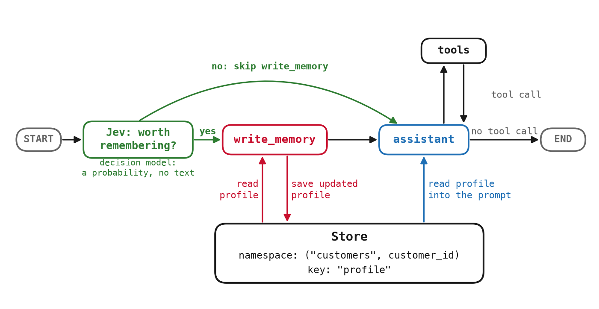

# Deciding When to Write Memory

A support agent that keeps a long-term profile of each customer usually asks the LLM to update the profile on every turn. This notebook puts a decision model, [Jev](https://docs.typesafe.ai/api/system-one) by TypeSafe, in front of that step: it decides whether a message is worth remembering, and the LLM updates the profile only when it is. The notebook compares Jev with an LLM making the same decision on 40 Husky Tech support messages, and counts the memory writes the gate saves in the agent.



## Files

- `Memory_Gate.ipynb`: the notebook, with outputs from a run with Claude Haiku
- `husky_cases.json`: 40 labeled customer messages, 20 of them worth remembering (synthetic; the passwords and account numbers in them are made up)
- `support_tools.py`: the Husky Tech support agent's tools and system prompt
- `figures/memory_gate_graph.png`: the agent's graph
- `example.env`: the keys the notebook reads, without values

## Running it

```bash
pip install langchain langgraph langchain-anthropic typesafe-sdk python-dotenv
```

Add `langchain-openai`, `langchain-google-genai`, or `langchain-ollama` instead of `langchain-anthropic` if you use another model. Copy `example.env` to `.env` next to the notebook and fill in `TYPESAFE_API_KEY` (from https://console.typesafe.ai/keys) and the key for your model, such as `ANTHROPIC_API_KEY`.
